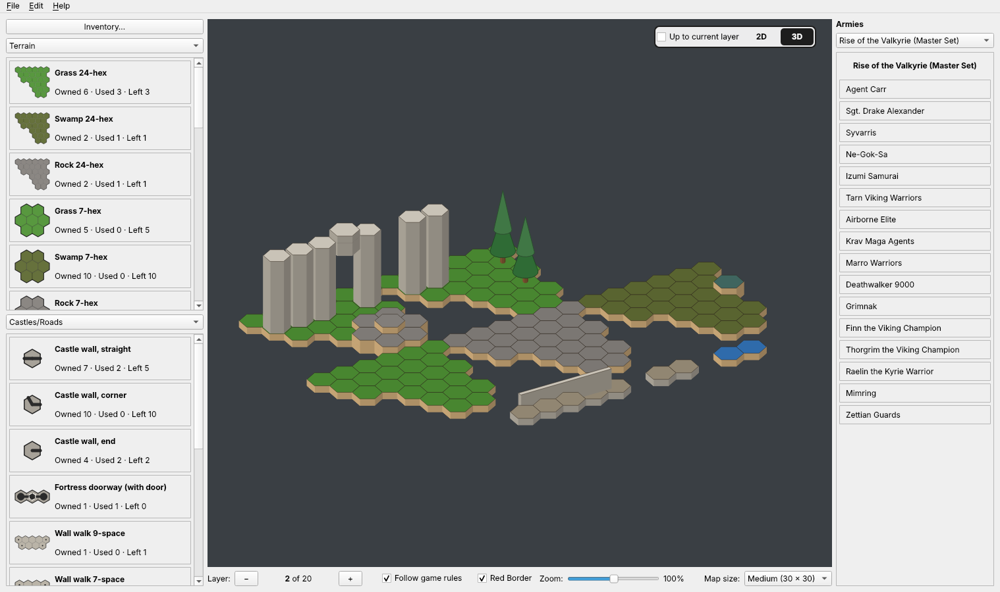

# Heroscape-Map-Builder
A Love affair with a silly game. Lets build custom maps together

A Linux desktop app for building Heroscape maps from the terrain tiles you own.

App entirely built by Claude ai and my imagination. 




## What it does (v1)

- Drag pieces from Rise of the Valkyrie, Road to the Forgotten Forest, Swarm of the Marro and
  Fortress of the Archkyrie onto a hex map: land, water, swamp, roads, trees, ruins, stone walls,
  castle walls, the fortress doorway, wall walks and ladders.
- Build up to 20 layers. You choose the layer you're building on.
- See the characters from the sets you own in the army builder on the right.
- Look at the map in 3D, turning it all the way round.
- Track how many of each piece you own, how many the map uses and how many are left.
  Going over is allowed: those tiles get a red outline and the count goes negative.
- Save and load maps as JSON files (`.hsmap.json`).
- Undo and redo the last 20 actions.
- Small (20 × 20), Medium (30 × 30) and Large (50 × 50) maps, picked from a drop-down under the map.
  New maps start Small.

## Running it on Linux Mint

You need Python 3.10 or newer (Linux Mint 21 and 22 both have it).

```bash
sudo apt install python3-venv git
git clone https://github.com/DeafComm/heroscape-map-builder.git
cd heroscape-map-builder
python3 -m venv .venv
.venv/bin/pip install -r requirements.txt
.venv/bin/python -m heroscape_builder
```

After the first time, start it with `.venv/bin/python -m heroscape_builder` from the
`heroscape-map-builder` folder. You can also open a map straight away:
`.venv/bin/python -m heroscape_builder mymap.hsmap.json`.

## Controls

| Action | How |
| --- | --- |
| Place a tile | Drag a piece from the left onto the map |
| Place several of the same tile | Click a piece, then click on the map for each copy. Right-click or Esc stops |
| Place another of the last tile | Right-click on the map. It uses the last tile's piece and rotation |
| Rotate | R (Shift+R the other way), while carrying a piece or with tiles selected. A tile you just placed stays selected |
| Select a tile | Click it. Only tiles on the current layer can be selected |
| Move a tile | Drag it. It stays on its layer |
| Select several tiles | Ctrl+click tiles on the current layer. Drag any of them to move them all as one block, or press R to turn the block |
| Remove tiles | Select them and press Delete, or drag them back onto the piece list |
| Scroll the map | Mouse wheel scrolls up and down. Ctrl+wheel scrolls left and right |
| Zoom | The zoom slider under the map (75% to 125%) |
| Choose what the piece lists show | Each of the two lists on the left has a drop-down: Terrain, Castles/Roads or Trees/Ruins |
| 3D view | The 2D / 3D switch in the top-right corner of the map. It shows only the tiles you've placed and spins in place: right-drag spins it smoothly, Q and E turn it 15°, and the wheel zooms. "Up to current layer" hides everything above the layer you're on. The 3D view is only for looking: pieces can't be dragged in while it's showing |
| Turn the red outline on or off | The Red Border checkbox under the map |
| Change layer | + goes up a layer, - goes down, or use the buttons under the map |
| Undo / redo | Ctrl+Z / Ctrl+Y (or Ctrl+Shift+Z) |
| Inventory | The Inventory button above the piece list, or Ctrl+I |

The current layer is shown in a box in the top-left corner of the map. Each hex shows the
number of the highest layer filled at or below the current layer, so from layer 3 you can see
every 2 you could build on. Tiles on layers below the one you're on get a white wash: the layer
just below gets a light wash, and each layer further down gets a heavier one. Tiles on layers
above the current one are faded and show no numbers. Tiles placed beyond what you own get a
thick red outline, shown only while you're on their layer.

Tall pieces (trees, castle walls, the doorway and ladders) fill several layers. Place them on
the layer above the tile they stand on, and pick them up from that same layer. Their hexes show
their top layer: a castle wall on a layer 1 tile fills layers 2 to 12, so it shows 12, and a
wall walk on it goes on layer 13.

The army builder on the right of the map has a drop-down to choose one of the sets you've
ticked in the Inventory window, and lists that set's characters. They're only listed for now, not placed on the map.

The map size drop-down under the map changes the size of the current map. File > New starts
an empty map at that size. If tiles would end up off the edge, the size isn't changed.
The map scrolls with the mouse wheel or the scroll bars when it's bigger than the window.

## Game rules

"Follow game rules" (under the map) is on by default. With it on:

- Every hex of a tile on layer 2 or higher must sit on a tile on the layer below.
- Water and swamp water can go beside land or on top of it, but nothing can go on top of
  water, swamp water or a ruin.
- Road and swamp tiles stack like land. The 5-hex road only needs tiles under its two end
  hexes, so it can bridge water, swamp water or empty space.
- Trees stand on land, road or swamp. Nothing can go on top of a tree or anywhere over it.
- A stone wall takes the 4 hexes beside a row of tiles and needs tiles on its layer along its
  whole length. Nothing can go in those hexes on its layer or above, but a wall on layer 2 or
  higher can have tiles under it.
- Castle walls (straight, corner and end) and the doorway stand on tiles and are 11 layers
  tall. Only wall walks can go on top of them. The doorway takes 3 hexes in a line.
- Each peg hex of a wall walk (marked with a dot) must sit on top of a wall or the doorway.
  The other hexes can hang free. Wall walks can be dropped from any layer: they snap onto the
  top of the walls under their pegs. A placed walk can be picked up or deleted from any layer
  (on a wall's own layer, a click picks the wall). Moving a wall leaves its walk where it is;
  deleting a wall deletes the walks on it too.
- A ladder stands against a castle wall on the same layer and uses 11 rungs.
- A piece that other pieces rest on or stand against can't be removed until they are.

With it off, pieces can float on any layer. Pieces can never overlap.

Battlements are counted in the inventory but not placed on the map yet.

## Inventory

Open the inventory window and tick the sets you own, with how many copies of each.
It's saved in `~/.config/HeroscapeMapBuilder/HeroscapeMapBuilder.conf` and loaded every
time the app opens. Rise of the Valkyrie, Road to the Forgotten Forest, Swarm of the Marro and
Fortress of the Archkyrie can be ticked; the other expansions are listed but greyed out.
Pieces that come in more than one set, like grass and water, share one row in the piece
list, with the counts from every set you own added together.

## Map file format

```json
{
  "format_version": 1,
  "name": "valley",
  "size": "medium",
  "follow_game_rules": true,
  "tiles": [
    {"piece": "grass.7", "q": 10, "r": 4, "layer": 1, "rotation": 0}
  ]
}
```

`q` and `r` are axial hex coordinates of the tile's anchor hex, and `rotation` is the
number of 60° clockwise turns (0 to 5). Maps saved before build 6 named pieces like
`rotv.grass.7`; those still open.

## Development

```bash
.venv/bin/pip install -r requirements-dev.txt
.venv/bin/python -m pytest
```

Piece types live in `heroscape_builder/data/`. `pieces.json` describes every piece (its
shape, kind and height), `sets.json` lists the sets, and each set with pieces has its own
file (such as `rotv.json`) giving how many of each piece it has and its characters.
