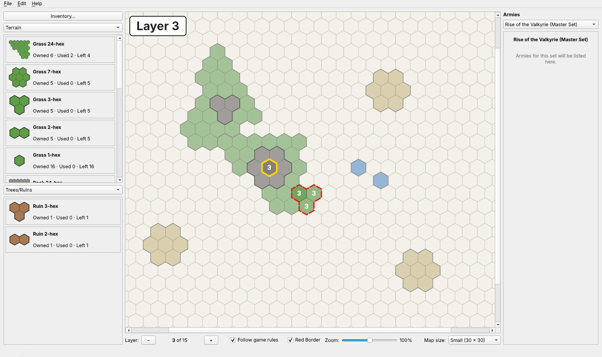

# Heroscape-Map-Builder
A Love affair with a silly game. Lets build custom maps together

A Linux desktop app for building Heroscape maps from the terrain tiles you own.



## What it does (v1)

- Drag land and water tiles and the two ruins from the Rise of the Valkyrie master set onto a hex map.
- Build up to 15 layers. You choose the layer you're building on.
- Track how many of each piece you own, how many the map uses and how many are left.
  Going over is allowed: those tiles get a red outline and the count goes negative.
- Save and load maps as JSON files (`.hsmap.json`).
- Undo and redo the last 20 actions.
- Small (30 × 30), Medium (50 × 50) and Large (80 × 80) maps, picked from a drop-down under the map.

## Running it on Linux Mint

You need Python 3.10 or newer (Linux Mint 21 and 22 both have it).

```bash
sudo apt install python3-venv git
git clone https://github.com/DeafComm/heroscape-map-builder.git
cd heroscape-map-builder
python3 -m venv .venv
.venv/bin/pip install -r requirements.txt
.venv/bin/python -m heroscape_builder
```

After the first time, start it with `.venv/bin/python -m heroscape_builder` from the
`heroscape-map-builder` folder. You can also open a map straight away:
`.venv/bin/python -m heroscape_builder mymap.hsmap.json`.

## Controls

| Action | How |
| --- | --- |
| Place a tile | Drag a piece from the left onto the map |
| Place several of the same tile | Click a piece, then click on the map for each copy. Right-click or Esc stops |
| Place another of the last tile | Right-click on the map. It uses the last tile's piece and rotation |
| Rotate | R (Shift+R the other way), while carrying a piece or with tiles selected. A tile you just placed stays selected |
| Select a tile | Click it. Only tiles on the current layer can be selected |
| Move a tile | Drag it. It stays on its layer |
| Select several tiles | Ctrl+click tiles on the current layer. Drag any of them to move them all as one block, or press R to turn the block |
| Remove tiles | Select them and press Delete, or drag them back onto the piece list |
| Scroll the map | Mouse wheel scrolls up and down. Ctrl+wheel scrolls left and right |
| Zoom | The zoom slider under the map (75% to 125%) |
| Choose what the piece lists show | Each of the two lists on the left has a drop-down: Terrain, Castle or Trees/Ruins |
| Turn the red outline on or off | The Red Border checkbox under the map |
| Change layer | + goes up a layer, - goes down, or use the buttons under the map |
| Undo / redo | Ctrl+Z / Ctrl+Y (or Ctrl+Shift+Z) |
| Inventory | The Inventory button above the piece list, or Ctrl+I |

The current layer is shown in a box in the top-left corner of the map, and layer numbers
only appear on tiles on the current layer. Tiles on layers below the one you're on get a white
wash: the layer just below gets a light wash, and each layer further down gets a heavier one,
so you can still see where the lower layers are. Tiles on layers above the current one are
faded. Tiles placed beyond what you own get a thick red outline, shown only while you're on
their layer.

The Armies panel on the right of the map has a drop-down to choose a set. For now it shows the
Rise of the Valkyrie title, and the armies will be listed there later.

The map size drop-down under the map changes the size of the current map. File > New starts
an empty map at that size. If tiles would end up off the edge, the size isn't changed.
The map scrolls with the mouse wheel or the scroll bars when it's bigger than the window.

## Game rules

"Follow game rules" (under the map) is on by default. With it on:

- Every hex of a tile on layer 2 or higher must sit on a tile on the layer below.
- Water can go beside land or on top of it, but nothing can go on top of water or a ruin.
- A tile with other tiles resting on it can't be removed until they are.

With it off, tiles can float on any layer. Tiles can never overlap on the same layer.

## Inventory

Open the inventory window and tick the sets you own, with how many copies of each.
It's saved in `~/.config/HeroscapeMapBuilder/HeroscapeMapBuilder.conf` and loaded every
time the app opens. Only the base set is available for now; the expansions are listed
but greyed out.

## Map file format

```json
{
  "format_version": 1,
  "name": "valley",
  "size": "medium",
  "follow_game_rules": true,
  "tiles": [
    {"piece": "rotv.grass.7", "q": 10, "r": 4, "layer": 1, "rotation": 0}
  ]
}
```

`q` and `r` are axial hex coordinates of the tile's anchor hex, and `rotation` is the
number of 60° clockwise turns (0 to 5).

## Development

```bash
.venv/bin/pip install -r requirements-dev.txt
.venv/bin/python -m pytest
```

Piece types live in `heroscape_builder/data/`. `sets.json` lists the sets, and each set
with pieces has its own file (such as `rotv.json`) giving the terrain, size and count of
each tile.
